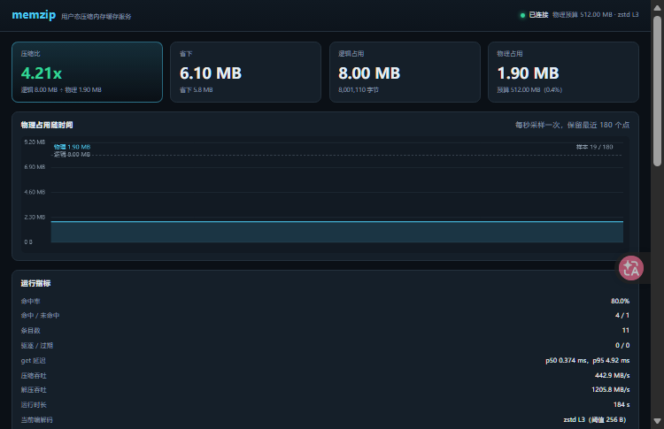
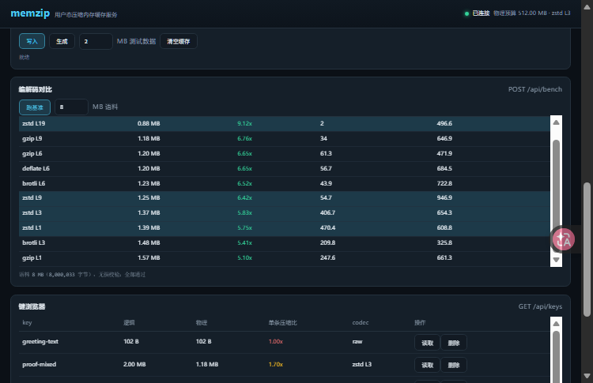

# memzip

A zero-dependency, user-space **compressed in-memory cache** for Node.js. Values are kept in RAM in zstd-compressed form and decompressed transparently on read, so the same physical memory holds several times more data. Ships with a CLI, an HTTP API and an offline Canvas dashboard.

**Not zram.** Real zram is a Linux kernel facility (kernel module + block device). A Windows user-space process cannot do that, and writing a driver is out of scope. memzip compresses data *inside this process* and decompresses only at the moment of a read — `store.set(key, value)` in, `store.get(key)` out, the caller never sees the compression.

**Benchmark** — 24.6 MB of real JSONL on Windows 10 / Node v24.14.1 (`node:zlib` native zstd):

| codec | compressed | ratio | compress MB/s | decompress MB/s |
|---|---|---|---|---|
| zstd L1 | 5.09 MB | 4.84x | 385 | 871 |
| **zstd L3** | **4.13 MB** | **5.96x** | **420** | **745** |
| zstd L9 | 3.28 MB | 7.51x | 107 | 773 |
| zstd L19 | 2.74 MB | 9.00x | 3 | 549 |
| gzip L6 | 5.23 MB | 4.71x | 73 | 455 |
| brotli L6 | 3.18 MB | 7.73x | 72 | 660 |

zstd L3 is the default: near-identical encode cost to L1 for 1.12 more points of ratio, and 4x–140x faster than L9/L19 (L19 needs 7.8 s on 24.6 MB — unusable on a write path). Decompression speed matters most, since reads dominate.

**Quick start** (Node ≥ 22.15, no `npm install`):

```
node bin/memzip.mjs serve --open      # dashboard on http://127.0.0.1:5398
node bin/memzip.mjs demo --mb 24      # logical vs physical vs ratio
node bin/memzip.mjs bench --mb 16     # full codec matrix
node test/smoke.mjs                   # 24 assertions
```

Three details make it hold up in practice: a compress threshold (values under 256 B are stored raw — zstd's empty-frame header alone is 9 bytes), a ratio guard (if compression did not shrink the value it is stored raw, never inflated), and an LRU budget measured in **physical** bytes, so the store can never exceed its memory cap.

Lossless roundtrip is asserted end to end: 5 MB of mixed binary in, identical sha256 and `Buffer.compare === 0` out. `test/rss-probe.mjs` is a controlled A/B memory probe proving the saving is real — uncompressed Δ24.07 MB vs compressed Δ4.25 MB of `arrayBuffers`, a ratio of 0.176 ≈ 1/5.741, matching `stats.physicalBytes`.

Limits: no persistence, no multi-process sharing, no transactions. Data lives in this one process and is gone when it exits. 中文说明见下。

---

**把数据压缩后常驻内存的本地缓存服务**——让同一块 RAM 装下更多东西，并带一个实时面板盯着压缩比、省下多少、吞吐与命中率。

> **结论先行**：这不是 zram。真正的 zram 是 Linux 内核级压缩内存（内核模块 + 块设备），Windows 用户态做不到，写驱动不在本项目范围内。
> memzip 是**用户态**的压缩缓存：数据在**进程内以压缩形态存放**，解压只发生在被读取的那一瞬间。调用方完全感知不到压缩——`store.set(key, value)` 进去什么，`store.get(key)` 就出来什么。
> 零依赖、纯 ESM、只用 Node 标准库（`node:zlib` 的原生 zstd）。

---

## 1. 实测基准：为什么默认 zstd L3

同一台机器（Windows 10 / Node v24.14.1）上，对 **24.6 MB 真实 JSONL 会话日志**跑出来的数字：

| 编解码 | 压缩后 | 压缩比 | 压缩 ms | 压缩 MB/s | 解压 ms | 解压 MB/s |
|---|---|---|---|---|---|---|
| zstd L1 | 5.09 MB | 4.84x | 64 | 385 | 28 | 871 |
| **zstd L3** | **4.13 MB** | **5.96x** | **59** | **420** | **33** | **745** |
| zstd L9 | 3.28 MB | 7.51x | 230 | 107 | 32 | 773 |
| zstd L19 | 2.74 MB | 9.00x | 7759 | 3 | 45 | 549 |
| gzip L1 | 6.31 MB | 3.90x | 151 | 163 | 59 | 417 |
| gzip L6 | 5.23 MB | 4.71x | 338 | 73 | 54 | 455 |
| gzip L9 | 5.18 MB | 4.75x | 664 | 37 | 45 | 549 |
| brotli L3 | 4.05 MB | 6.07x | 133 | 184 | 45 | 541 |
| brotli L6 | 3.18 MB | 7.73x | 340 | 72 | 37 | 660 |

**结论：zstd L3 是甜点（5.96x / 420 MB/s），所以它是默认值。**

理由不只是"压缩比还行"：

- 相比 zstd L1，L3 用几乎相同的耗时（59 ms vs 64 ms）多换了 1.12 个百分点的压缩比；
- 相比 zstd L9/L19，L3 的压缩比低一些，但**编码快 4 倍到 140 倍**——L19 在 24.6 MB 上要 7.8 秒，作为在线缓存的写入路径完全不可接受；
- 相比 gzip/brotli，zstd 在**解码**侧同样快（745 MB/s，读取路径才是高频路径）；
- zstd 的等级是连续的（1–22），需要离线归档时可以临时切 L19，接口不变。

本仓库的 `bench` 命令可以在真实文件上复现这张表。用一份 25.8 MB 的真实 DSH 会话日志（`.zstd` 多帧文件，见 §7）跑出来的结果与上表逐项吻合：

| 编解码 | 压缩后 | 压缩比 | 压缩 ms | 压缩 MB/s | 解压 ms | 解压 MB/s |
|---|---|---|---|---|---|---|
| zstd L19 | 2.87 MB | 9.00x | 6866 | 3.8 | 32.15 | 802.5 |
| brotli L6 | 3.34 MB | 7.73x | 380 | 67.9 | 39.38 | 655.2 |
| zstd L9 | 3.44 MB | 7.51x | 215 | 119.8 | 33.72 | 765.2 |
| brotli L3 | 4.25 MB | 6.07x | 124 | 208.8 | 47.05 | 548.4 |
| **zstd L3** | **4.33 MB** | **5.96x** | **62** | **414.7** | **28.33** | **910.7** |
| zstd L1 | 5.33 MB | 4.84x | 44 | 589.1 | 28.79 | 896.2 |
| gzip L9 | 5.43 MB | 4.75x | 688 | 37.5 | 56.35 | 457.9 |
| gzip L6 | 5.48 MB | 4.71x | 323 | 79.8 | 54.96 | 469.4 |
| deflate L6 | 5.48 MB | 4.71x | 369 | 69.9 | 47.77 | 540.1 |
| gzip L1 | 6.62 MB | 3.90x | 162 | 159.7 | 61.77 | 417.7 |

单位说明：**1 MB = 1,000,000 字节**（十进制），全项目统一；"压缩比 = 逻辑字节 ÷ 物理字节"。

---

## 2. 快速开始

要求：**Node ≥ 22.15**（`node:zlib` 的原生 zstd 从这一版开始提供）。没有其它依赖，不用 `npm install`。

```
node bin/memzip.mjs serve --open
```

浏览器打开 http://127.0.0.1:5398/ 就是面板。先用命令行感受一下：

```
node bin/memzip.mjs demo --mb 24
node bin/memzip.mjs bench --mb 16
node bin/memzip.mjs info
```

---

## 3. CLI

| 命令 | 说明 |
|---|---|
| `serve [--port 5398] [--max-mb 512] [--codec zstd] [--level 3] [--min-bytes 256] [--open]` | 起 HTTP 服务 + Web 面板 |
| `bench [--file <路径>] [--mb 16] [--codec zstd] [--json]` | 对比所有编解码，输出压缩比 / 吞吐表 |
| `demo [--mb 24] [--file <路径>] [--codec zstd] [--level 3] [--json]` | 塞入 N MB 数据，打印逻辑/物理/压缩比/省下/耗时 |
| `put <key> <value\|@文件> [--ttl <毫秒>] [--url ...]` | 写入一条（`@` 前缀表示读文件里的二进制） |
| `get <key> [--out <文件>] [--json]` | 读回原值（默认写标准输出） |
| `stats [--url ...] [--json]` | 打印服务端指标 |
| `info` | 打印本机编解码能力与默认参数（不需要服务在跑） |

`put`/`get`/`stats` 通过 HTTP 与正在运行的 `serve` 通信（默认 `http://127.0.0.1:5398`，可用 `--url` 或环境变量 `MEMZIP_URL` 覆盖）。`info` 是纯本地命令。

---

## 4. HTTP API（冻结契约）

所有响应都带 `Cache-Control: no-store`；所有错误都是 JSON：`{ "error": { "code": "...", "message": "..." } }`。

| 方法与路径 | 说明 |
|---|---|
| `GET /api/stats` | `{ entries, logicalBytes, physicalBytes, ratio, savedBytes, hits, misses, hitRate, evictions, expired, topCodecs, p50GetMs, p95GetMs, uptimeMs, maxBytes, ... }` |
| `POST /api/kv` | body `{ key, value, ttlMs? }`（也可 `encoding:"base64"`）→ `{ key, logicalBytes, physicalBytes, ratio, stored }` |
| `POST /api/kv?key=<key>` | `Content-Type: application/octet-stream`，body 即原始字节（二进制最可靠的写入路径） |
| `GET /api/kv/:key` | 原值，`Content-Type: application/octet-stream`；不存在则 404 JSON |
| `DELETE /api/kv/:key` | 删除，返回 `{ deleted: true, key }` |
| `GET /api/keys?limit=&cursor=` | 键列表（LRU 顺序，带物理/逻辑大小与单条压缩比） |
| `POST /api/bench` | body `{ mb?, codec? }` → 各编解码在该数据上的实测结果 |
| `POST /api/flush` | 清空，返回 `{ ok: true, flushed: n }` |
| `GET /api/info` | 版本、Node、编解码能力、当前 store 配置 |

`GET /api/kv/:key` 的响应头附带足够自查的信息：`X-Memzip-Value-Type`、`X-Memzip-Logical-Bytes`、`X-Memzip-Physical-Bytes`、`X-Memzip-Ratio`、`X-Memzip-Stored`、`X-Memzip-Codec`、`X-Memzip-Sha256`、`X-Memzip-Decompress-Ms`。

例子（含 5 MB 无损往返）：

```
# 写入二进制并取回，逐字节比对
node bin/memzip.mjs put photo @D:/data/blob.bin
node bin/memzip.mjs get photo --out D:/data/blob.out

# HTTP 直接来
curl -X POST "http://127.0.0.1:5398/api/kv?key=hello" ^
     -H "Content-Type: application/octet-stream" --data-binary @blob.bin
curl -s http://127.0.0.1:5398/api/stats

# JSON 通道（文本/JSON 值）
curl -X POST http://127.0.0.1:5398/api/kv ^
     -H "Content-Type: application/json" ^
     -d "{\"key\":\"greeting\",\"value\":\"你好，压缩内存\"}"
```

---

## 5. Web 面板

打开 http://127.0.0.1:5398/ ：

- **大数字卡**：压缩比 / 省下多少 MB / 逻辑占用 / 物理占用（含预算占比）；
- **实时图表**：Canvas 手绘的物理占用曲线（虚线是逻辑占用做参照），每秒采样一次、保留最近 180 个点；
- **编解码对比表**：一键跑 bench，把各编解码的压缩比与吞吐列出来，**高亮当前选用的 codec**；
- **键浏览器**：列出 key 与各自的逻辑/物理大小、单条压缩比、codec，可逐条读取或删除，支持游标翻页；
- **操作区**：写文本、生成 N MB 测试数据、一键清空；
- 每秒轮询 `/api/stats`，暗色主题、系统字体，**零 CDN、零框架、可离线**；所有文本都通过 `textContent` 写入（不用 `innerHTML`）。



上面的数字来自面板自己生成的测试数据（8 MB 逻辑 / 1.90 MB 物理），下面是编解码对比表与键浏览器——表格里高亮的那行就是当前选用的 codec：



---

## 6. 三个必须做对的工程细节

`set(key, value)` 把任意值（string / Buffer / JSON 对象）压缩后存放，`get(key)` 透明解压返回原值。为了让这件事在真实系统里成立，有三条不能省：

1. **压缩阈值** `minCompressBytes`（默认 256 B）：小于阈值的值**不压缩直接存**。
   小值压缩后往往更大，还白搭 CPU——zstd 的空输入帧本身就有 9 字节头部，一段 80 字节的短字符串压缩后可能变成 90 字节。真实缓存系统都会这么做。
2. **压缩比守卫**：如果压缩后没有变小，就存原始数据并在元数据里标记 `stored: "raw"`。
   绝不为了"用上压缩"而占更多内存（随机字节、已压缩过的图片/视频就是这样）。
3. **物理内存上限 + LRU**：`maxBytes` 是**物理（压缩后）字节**预算，不是逻辑大小。
   超了就从最久未使用的一端淘汰；因为物理占用是逐条精确记账的（`physical -= entry.physicalBytes`），STORE 的物理占用**恒不超过上限**（单条本身就超预算时默认拒绝写入：库抛 `VALUE_TOO_LARGE`，HTTP 回 **413**；可用 `allowOversize` 放开）。

另外：

- **TTL**：`ttlMs`（或全局 `defaultTtlMs`）到期后该条目即失效；清理是惰性的（读取时判断 + 每秒最多一次的 sweep），过期计数体现在 `stats.expired`。
- **零拷贝读路径**：HTTP 层用 `store.fetch()` 直接拿解压后的 Buffer，避免"解压一次给指标、再解压一次给响应"。
- **指标口径**：`hits/misses` 只在 `get/fetch` 上计；`logicalBytes/physicalBytes` 是当前存活条目的即时账目，`hits/misses/evictions` 等是进程生命周期内的累计量；`ratio = logicalBytes ÷ physicalBytes`；`savedBytes = logicalBytes − physicalBytes`；`p50/p95` 取自最近 8192 次 get 的延迟环形缓冲。

---

## 7. 关于语料：真实数据 vs 合成数据

- `bench --file <路径>` 直接吃真实文件。如果文件是多帧 zstd（DSH 会话日志 `.jsonl.zstd` 就是"一个 flush 一帧"的拼接文件），会先逐帧解压再统计——Node 的 `zstdDecompressSync` / `createZstdDecompress` 都**只给第一帧**（实测某个 5055 帧的文件只解出 245 字节），所以这里按魔数 `28 b5 2f fd` 切帧。
- `demo` 默认按约 256 KB 一条写入（模拟真实的批量写入而不是一次性大块），所以它的压缩比会比 `bench` 的整文件压缩略低（真实日志上 4.82x vs 5.96x）——这是分块压缩失去跨块冗余的正常代价，不是 bug；想要更高的比值就调大 `--chunk-kb`。
- 不带 `--file` 时用**确定性合成语料**（固定 seed 的 PRNG 生成类 JSONL 日志，形状与真实会话日志接近，zstd L3 下约 5.8x）。合成不是为了好看：它让 `bench` 在任何机器上都可复现、可比。

---

## 8. 诚实性：物理占用真的等于省下的内存吗

接受质疑的地方在这里。`stats.physicalBytes` 是**逐条累加的压缩后字节数**，它不代表进程 RSS 只涨这么多。两者之间的差距来自：

- V8 堆的分配粒度与碎片（压缩缓冲区都是小块 Buffer，来自 ArrayBuffer 分配器）；
- 写入路径上的临时对象（编码后的原始字节、压缩输出）；
- Node 运行时自身的开销与 GC 时机（RSS 只会缓慢归还给操作系统）。

所以正确的对照方法是：**看方向，不看等号**，而且要做受控对照。`test/rss-probe.mjs` 就是这么做的——同一份 24 MB 语料，先用「完全不压缩」存一遍、释放掉，再用 zstd L3 存一遍，每一步都强制 GC 后读内存账目：

| 阶段 | RSS | arrayBuffers | ΔRSS | ΔarrayBuffers |
|---|---|---|---|---|
| 0 基线（语料已就位） | 182.47 MB | 24.02 MB | - | - |
| 1 未压缩写入后 | 206.40 MB | 48.08 MB | 23.93 MB | **24.07 MB** |
| 2 释放未压缩后 | 182.56 MB | 24.08 MB | 0.09 MB | 0.07 MB |
| 3 zstd L3 写入后 | 187.76 MB | 28.33 MB | 5.20 MB | **4.25 MB** |

- **arrayBuffers** 是进程内所有 Buffer/ArrayBuffer 的归属字节，和 `stats.physicalBytes` 是同一本账：未压缩路径的增量 24.07 MB ≈ 逻辑大小 24 MB；压缩路径的增量 4.25 MB ≈ `stats.physicalBytes` 的 4.18 MB。两者比值 **0.176 ≈ 1 / 5.741**，正好是压缩比的倒数——**省下的内存是真的，量也对得上**。
- **RSS** 额外含 V8 堆、分配器碎片、zstd 编码时的临时工作区，以及 GC 还没归还给操作系统的页，所以压缩路径 ΔRSS 5.20 MB 略高于 4.18 MB。方向与量级都正确，但它不是精确账目。

推荐运行方式（`--expose-gc` 让临时垃圾及时回收，数字才干净）：

```
node --expose-gc test/rss-probe.mjs --mb 24
```

---

## 9. 自检

```
node test/smoke.mjs
```

覆盖：string/Buffer/JSON 往返、阈值灰区、压缩比守卫、LRU 与预算不越界、TTL 过期、100 并发不串数据、读不存在的 key 不抛、指标与实际账目一致、四个编解码各自无损、多帧 zstd 解码、HTTP 全链路（含 5 MB 混合数据逐字节一致、404/400、路径穿越防护）。

输出形如 `PASS <name>` / `FAIL <name> - <reason>`，末行 `<n> passed, <m> failed`，有失败时退出码 1。

---

## 10. 目录结构

```
memzip/
  bin/memzip.mjs      CLI：serve | bench | demo | put | get | stats | info
  src/codec.mjs       编解码注册表（zstd / gzip / brotli / deflate，可注册自定义）
  src/store.mjs       压缩 KV 存储：LRU + TTL + 物理预算 + 阈值 + 比值守卫
  src/metrics.mjs     指标：逻辑/物理字节、命中率、吞吐、延迟分位
  src/bench.mjs       基准矩阵 + 语料生成（含多帧 zstd 读取）+ 终端表格
  src/server.mjs      HTTP API + 静态资源
  web/index.html      面板
  web/app.js          前端（原生 JS）
  web/style.css       暗色样式
  test/smoke.mjs      自检
  test/rss-probe.mjs  物理占用诚实性探针
  docs/panel.png      面板截图（压缩比 / 图表 / 运行指标）
  docs/panel-bench.png 编解码对比表与键浏览器
  docs/panel-keys.png  键浏览器细节
```

---

## 11. 边界与不做的事

- **不碰系统**：纯用户态，不改系统设置、页面文件、注册表，不装驱动；
- **不做持久化**：这是内存缓存，进程退出数据就没了（重启即冷启动）；
- **不是通用数据库**：没有事务、没有多进程共享、没有跨进程锁；
- **不做分布式**：单机单进程；
- **不替你省系统内存**：省下的是**这个进程**的堆内存；要省全系统的内存，去用 zram / 页面文件压缩。

## License

MIT
